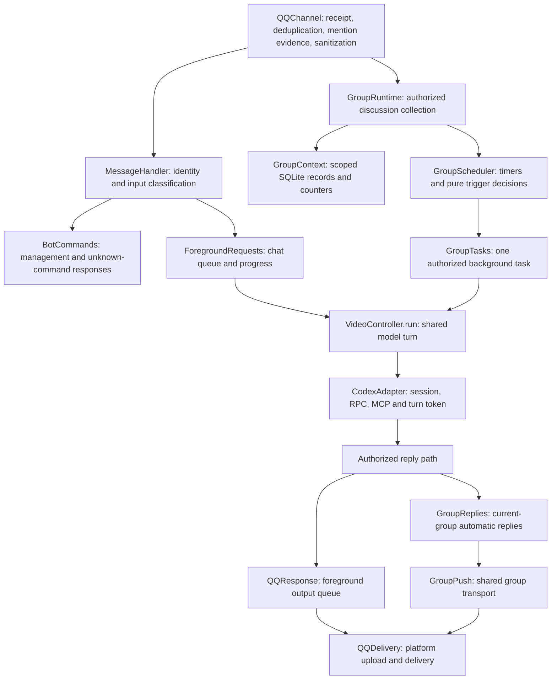

# Message and task boundaries

This document describes current source ownership. See [HANDOFF.md](../HANDOFF.md) for deployment ownership and status.



All non-command group messages, including bot mentions, pass through collection and stop before `MessageHandler`; they do not become individual foreground requests. `MessageHandler` also ends group handling after command dispatch, and `ForegroundRequests` accepts private conversations only. A persisted `botMentioned` flag in the existing message detail makes the pending batch immediately eligible through the shared `groupDecision` policy, including active-turn event intake. Mention evidence is captured before sanitization strips textual bot markers. Bot control commands, including unknown slash commands, are excluded from discussion collection and do not trigger automatic chat.

`QQChannel` normalizes face tags without dropping unknown codes and strips only the bot mention after mention evidence is captured. `MessageRecords` captures the bounded delivered graph, while the shared `message.record` → `message.content` codec supplies foreground input, group batches and explicit detail results. Records have `type: "record"` and an ordered `components` array. Message metadata (ID, speaker, timestamp, source, retention flags) stays on the record; content is represented by `text`, `image`, `audio`, `video`, `file`, `card`, `mentions`, or nested records. Cards retain their structured delivered fields, including safe links; audio retains optional unverified platform transcripts. No model-generated summary or automatic nested-body expansion occurs. Quote/forward relationships use nested record components; unresolved message references have empty components and explicit status. Only the record/component schema is supported. `get_message_detail(id, offset, limit)` reads one direct-child page, with `nextOffset` for pagination and item `messageId` for further nested reads. Scope, collection access and retained existence are rechecked before returning any bodies. This reads local retained records, not QQ history. The `get_message_detail` action returns that JSON page followed by up to three distinct actual images found in the returned parent/direct children, using the shared `MessageImages.read` authorization/download path. `include_images=false` opts out; extra image IDs remain available through `get_image_detail`. Images from deeper unexpanded descendants are not prefetched. After media acquisition the action rechecks every returned message and its access, so clearing/revocation discards buffered text and pixels. Image-specific expiration/download failures stay explicit alongside the retained text.

## Content streams and codecs

`content-stream.mjs` represents a typed, lazy sequence of content units. A unit can be a whole message, an image with provenance, or a frame/chunk supplied by a media source; it is not necessarily bytes. Sources are ordinary sync/async iterables, and consumers use `for...of` or `for await...of`. There is no dependency on QQ, MCP, an LLM endpoint or a particular transport.

`content-codecs.mjs` registers explicit source/target conversions. `stream(type, source)` creates a flow; `value(type, value)` creates a one-unit flow. `.to(target, context)` attaches an item codec, while `.through(target, transform)` attaches a stream transform that may split or combine units. Stream transforms receive the upstream flow and return a lazy iterable, normally a generator. Callers select every stage; missing/duplicate routes fail explicitly. Trusted modules register codecs during setup; received data and model tools cannot register code.

```js
// The same decoder handles a file iterator or a program's async iterator.
const flow = codecs.stream('bytes', authorizedSource)
  .to('text')
  .through('text', splitLines)
  .to('record', options);
for await (const record of flow) await destination.write(record);
```

That example assumes application-provided codecs, a line-splitting generator and an authorized destination. It does not introduce file access or a byte decoder into the bot. Stream transforms own their own boundary state; a byte decoder must handle code points split between chunks rather than independently decoding each chunk.

Transforms run on demand. Async iteration awaits each conversion without prefetching; early exit or a failed conversion closes upstream generators. Source generators own resource cleanup and cancellation checks; this is not a transport-abort mechanism. `.single()` handles synchronous one-unit boundaries and rejects empty/multiple items or async stages. `.collect()` explicitly buffers an async flow; callers must bound the source first. Streams do not retain history, create tasks or replay consumed iterators. Arrays returned by a codec remain a single unit, preserving existing MCP image-block grouping; use a stream transform when splitting is intended.

| Source → target | Owner | Purpose |
| --- | --- | --- |
| `qq.message` → `message.record` | `message-codecs.mjs` | Decode delivered fields/attachments using capture-provided references; return private URLs separately for storage |
| `message.record` → `message.content` | `message-codecs.mjs` | Render record components recursively, preserving structured cards and unresolved nested references |
| `json` → `text` | `content-codecs.mjs` | Serialize structured data for any consumer |
| `json` / `text` → `mcp.content` | `mcp-codecs.mjs` | Encode structured/text tool results at the endpoint |
| `audio.pcm` → `audio.speech` (stream transform) | `audio-decoder.mjs`, `audio-worker.mjs` | Bounded Silero VAD segments with surrounding samples and original-media offsets |
| `audio.speech` → `audio.transcript` → `text` | `audio-codecs.mjs` | Local Qwen speech recognition and optional plain-text encoding |
| `image` → `mcp.content` | `mcp-codecs.mjs` | Encode image bytes and untrusted provenance as MCP blocks |

`agent-input.mjs` assembles a backend record containing text components, the current message and a nested group-batch record. Synthetic wrappers have no invented speaker or message timestamp. The record is serialized once for the text-based model transport; original request text remains available in full independently of bounded retained previews. `record.mjs` traverses only materialized components and performs no reference fetches.

Message consumers select stream stages directly. Tool actions return an ordered array of typed streams; `tools/register.mjs` consumes them through `mcp.content` codecs and flattens their block arrays into one MCP response. It encodes custom failure results through the same path, discarding buffered partial success on a failed stream. Tool and image-source modules do not construct MCP blocks. Image signature inspection lives in `image-policy.mjs` and has no endpoint dependency. The generic stream/registry contain no endpoint codecs. Permission checks, scoped reference resolution, download limits, storage, cancellation and delivery stay with callers. Video extraction and QQ delivery keep their current lifecycle. Optional local audio decoding attaches a VAD stream transform and a speech-to-transcript item codec. `audio-source.mjs` separately extracts bounded PCM from an authorized local audio/video file with ffmpeg. `AudioDecoder` owns a lazy native child process, serial inference, timeout/cancellation and model lifetime; caller scheduling and authorization remain outside it. The isolated runtime and model files are explicitly installed separately, not fetched by bot startup. `scripts/transcribe-audio.mjs` is an operator entry. QQ audio is connected on demand through `get_audio_detail(id, method)`: `qq` reads retained platform text, `local` resolves the scoped attachment URL and runs the decoder. `message-audio.mjs` owns acquisition, repeated access/retention checks, temporary-file cleanup, bounded output and the total deadline. `audio-slot.mjs` enforces one local job across MCP processes without retaining chat data. SILK uses a separate bounded WASM child source, other supported audio uses ffmpeg. The MCP registrar passes request cancellation signals to handlers. Local jobs close the model after each call; Bilibili stream/audio integration is ON HOLD pending QQ pipeline validation and an explicit extension request. See [audio decoder](audio-decoder.md) for configuration, output semantics and unverified resource limits.


## Ownership

| Module | Owns | Does not own |
| --- | --- | --- |
| `qq-channel.mjs` | QQ connection, middleware, request/receipt metadata, transport lifecycle | Command matching, model queues, background policy |
| `message-input.mjs` | Command classification and attachment-only input fallback | Authorization or execution |
| `content-stream.mjs`, `content-codecs.mjs` | Typed lazy flows, explicit item codecs and stream transforms | Transport, authorization, task scheduling or persistence |
| `record.mjs` | Recursive record/component shape, shape validation and materialized traversal | I/O, reference expansion or authorization |
| `message-codecs.mjs` | QQ field decoding and recursive component encoding | Download, authorization or delivery |
| `mcp-codecs.mjs`, `tools/register.mjs` | Endpoint encoding of typed tool streams, error responses and explicit tool registration policy | Data acquisition or business authorization |
| `message-elements.mjs` | QQ face normalization, bounded structured card destination extraction (traditional fields and mini-app metadata), format metadata and embedded-node capture | Fetching missing platform bodies/images, inventing destination URLs or identity verification |
| `message-audio.mjs`, `audio-slot.mjs` | Scoped audio retrieval, explicit QQ/local selection, a shared local inference slot and cleanup | User identity, public downloads or music understanding |
| `message-records.mjs` | Scoped incoming/confirmed-reply records, reply media and bounded one-level detail reads | Media download, authorization policy or model calls |
| `message-handler.mjs` | Administrator claim, identity/access checks, command-versus-chat dispatch | Progress, inference, group batching |
| `admin-settings.mjs`, `group-settings.mjs` | Operator navigation, concise setting effects, scoped actions and returns | Developer diagnostics or transport policy |
| `diagnostic-report.mjs`, `diagnostic-summary.mjs`, `diagnostic-file.mjs` | One cached, bounded metadata-only report with scope tags and structured errors | Message bodies, model calls, live platform refresh or diagnostic subpages |
| `qq-ui.mjs` | Command keyboards and owned private-menu synchronization/backup | Identity checks or unrelated menu entries |
| `commands.mjs` | Complete command dispatch, permissions, local unknown/malformed-command responses | Ordinary model input or model progress |
| `foreground-requests.mjs` | Foreground serialization, cancellation epoch checks, progress, input-record preparation | Management commands or group collection |
| `conversation-events.mjs` | Conversation-local new-input intake, turn-owned guards and interruption deadline | QQ transport, model protocol or persistent records |
| `tools/events.mjs` | Token-bound event/guard MCP schemas and guidance through the existing turn IPC | Authorization changes, message sending or process cancellation |
| `chat-records.mjs` | Common scoped clearing and physical departure removal after cancellation | Authorization, model calls or service settings |
| `group-runtime.mjs` | Group collection, configuration binding, active-turn batch-event timers, scoped record clearing, metadata-only runtime status | Model calls, prompt construction or QQ sends |
| `group-policy.mjs` | Pure scheduling and shared task/reply authorization, including reservation ownership | Timers, storage mutation or delivery |
| `group-scheduler.mjs` | Timer lifecycle and reloading the group before task dispatch | Models or QQ transport |
| `group-tasks.mjs` | One background task, its authorized sender, completion and processed-position acknowledgment | QQ protocol or inline prompts |
| `group-task-instructions.mjs` | Group batch, discovery and idle-starter task wording | Authorization or execution |
| `controller.mjs` | Component assembly, conversation lanes, model-turn coordination, stop/recovery and service lifecycle | Command routing, receipt collection or management page branches |
| `codex-adapter.mjs` | Restricted model process, session/turn protocol, MCP configuration and reply binding | QQ authorization or group scheduling |
| `group-replies.mjs` | Per-turn automatic-speech state, owned reservation and per-message rechecks | Enabling switches or creating model tasks |
| `qq-response.mjs` | One foreground request's output order, passive quota, feedback forwarding and completion | Starting a model task |
| `qq-delivery.mjs` | One `send(scope, content, options)` entry for text/media/files/buttons, ordered delivery and transport errors | Choosing whether a background group may speak |

`VideoController.run` loads group configuration directly from the group conversation scope. It must not rely on an earlier scheduler/settings action having copied a group ID or owner into an in-memory lane. That persisted record determines the preference owner, model context and available background reply tools.

`groupTaskAccess` is shared by background orchestration, model-tool exposure and group sending. A sender may ignore its own `pushPending` reservation only when the owner matches; it must still check authorization, collection, feature switches and stop state. An unrelated reservation is temporary contention, not administrator stop. An automatic-chat batch waits rather than consuming its discussion while another send owns the reservation.

## Cross-conversation context

`ChatContext` owns source/target policy, turn-local read aliases and private self-service sharing controls in the main process. `AdminSettings` persists `shareContext=false` and `sharingRevision=0` by default alongside existing preferences; every explicit sharing change increments the revision. `/context-sharing [on|off]` applies to the verified private sender's own chat, including non-administrators accepted by the input gate. Group commands cannot mutate it. Administrator Private chat settings link to this page. Sharing covers retained messages/media/bot replies, including pre-opt-in material; it survives ordinary settings updates/restarts/scoped clearing. Stops, contact removal, maintenance and target epochs still revoke reads. Revocation cannot recall evidence already supplied to another model or explicitly saved copies.

`Controller` supplies the capability only to authorized foreground private turns and reply-capable discussion batches. `CodexAdapter` binds it to the current `ReplyBridge` token; discovery/idle starters have no callback. `list_context_chats` returns opaque aliases for other allowed/collecting/unpaused groups and opted-in private contacts/configured administrators, with untrusted group labels and generic private labels. Sending aliases grant no history access. Every read rechecks source/target policy, sharing revision, stops, maintenance, epoch and retained record existence after acquisition. Closed/cancelled turns discard buffered results. Shared reads do not write input receipts, batch cursors or summaries, create target inference or replay messages. Conversation model threads remain separate; the model can query shared evidence to continue topics across them.

`MessageRecords.contextPage` queries retained incoming and `bot_reply` records with parameterized keyword/received-time/offset filters. Default window is ten minutes; each page returns up to 20 records/about 12,000 characters. Long text previews are marked; oversized structured records return `DETAIL_REQUIRED` rather than disappearing. Received timestamps and original timestamps remain distinct; arrivals may shift offset pages. Recursive records preserve graph/image/attachment references. Top-level speaker identities become turn-local pseudonyms, bot speakers retain the assistant role, and shared detail projection removes backend OpenIDs/administrator markers. Content is untrusted context, never a new task or authorization. Media references are not viewed/heard evidence. Notes/external searches cannot contain chat bodies.

`ContextAccess` privately resolves a turn's chat alias to a backend scope over the same IPC; that scope is never model output. Existing `get_message_detail`, `get_image_detail`, `get_audio_detail`, `read_media` and `save_file` accept `context_chat` plus `turn_id`. Message details retain one-level paging; shared image reads use the common checked loader and sanitized source metadata. Audio uses injected shared-access checks around the existing acquisition/ASR owner. Media sessions retain their original sharing guard even when later addressed only by `media_id`; they share the existing per-turn session/query/cache/decoder budgets across all source chats. Source acquisition and cached output both recheck sharing. Saving an authorized attachment/image explicitly creates an independent current-workspace copy with sanitized provenance; no other workspace/project access is granted. Received files retain existing codecs, format/size limits and explicit binary-parser limitations. `reply_media` provides actual retained image/audio bytes for bot evidence without fabricating a QQ download URL.

`QQDelivery.send` archives only submissions explicitly tagged `history=true` after platform acceptance; normal foreground replies, routed replies and group publications use this flag. Operator pages, tool feedback/errors, keyboards, login/QR data, rejected or uncertain sends are excluded. `QQChannel` supplies the guarded main-service `MessageRecords.captureReply` callback with a pre-send epoch: maintenance/clearing or epoch changes prevent late writes from resurrecting cleared data. Reply records and media use one SQLite transaction, existing seven-day expiry and separate incoming/outgoing limits of 5,000 records per group/512 per private chat. Text archives cap at 12,000 characters with a truncation marker, without changing delivered prose. Outgoing history never displaces incoming records. Scoped clear removes both reply records and media BLOBs; no migration invents older replies. Archive failures record fixed `reply_history_failed` metadata and notify administrators separately; accepted transport results remain accepted, without retry/compensation. Shared-context storage failures similarly report fixed `chat_context_failed` metadata independently of monitoring. Normal operation feedback retains the adapter/update/administrator/delivery path; no aliases, queries or bodies enter diagnostics.

## Commands and progress

Starting the model's final structured output does not emit a reply-preparation hint: final JSON can complete a silent turn and is not a chat submission. Actual `send_reply` events retain their existing start/result feedback.

Group More settings and private Run feedback each expose one opt-in `toolMonitor` switch for both processing states and tool execution. Saved group progress/monitor preferences are merged when read, and subsequent ordinary settings updates retain only the unified switch without changing task stops or reservations. `RequestUpdates` translates actual events into plain operator-facing action/outcome/elapsed-time messages; `ForegroundRequests` and `GroupTasks` send them through `AdminNotifications` to administrator private scopes. The notifier rechecks the single source switch, collection/engagement/stop state, cancellation and administrator membership. Hints use no group send reservations or chat quotas, never count as answers and never supply chat output. Their delivery failure records metadata only; there is no source-chat fallback or automatic retry.


Every slash command is resolved by `BotCommands.dispatch` before `ForegroundRequests` is entered. Malformed/unknown commands return a local hint without creating progress, queueing inference, or interrupting background browsing.

Administrator home separates private-chat, group, role, video-preference, browsing and data actions. Markdown supplies short operator-facing descriptions; button payloads retain existing scoped commands and authorization. Private model pages return to Private chat, group pages return to their selected group, and record maintenance returns to Data. Clearing keeps its original confirmation and permission gates. The Run feedback page (`/settings display`) is reachable from administrator home/private settings and contains the private Run feedback switch and the single `/debug` report button. Each group’s More page controls unified feedback for that group’s reply-authorized discussion batches; model commentary is not forwarded. The report returns to that page. `diagnostic-summary.mjs` puts fixed, evidence-limited interpretations before the raw appendix: recent private failures and guidance, configured audio model-path presence (not dependency/file readiness), current group stops, scope/task-correlated model/tool/send stages, historical failures and observed reconnect timing. It uses the same allowlisted, deduplicated metadata as `diagnostic-file.mjs`; successful QQ submission never proves that a failed tool worked, and later success of the same tool does not prove the same operation recovered. No model-assisted log summarization or active probing is introduced. The only diagnostic UI action is `/debug`, which assembles cached service/current-private/group metadata into one TXT file; no platform refresh, chat-body read, inference or old diagnostic pagination is involved. Detailed errors and Trace IDs belong in that file; ordinary notices use brief service/action messages. The fixed private menu contains Help, Administrator settings and Stop tasks. Known legacy video shortcuts are removed during normal startup synchronization while custom entries and the original backup remain.

Model/session mutations still serialize through `changeConversation`; read-only pages do not wait for inference and `/stop` remains immediate. Private monitoring is opt-in for the administrator foreground private scope, while the single group feedback switch cover authorized discussion batches only. All hints share the administrator-notification route. `CodexAdapter` pairs native web-search/MCP item IDs and emits actual start/result/interruption metadata with elapsed time. Repeated calls remain separate. Native search action/result URLs and read/render MCP URL arguments pass through `web-feedback.mjs` into ephemeral administrator feedback, with at most three deduplicated public-web HTTP(S) URLs independent of the acquisition allowlist. Credentials, nonstandard ports, adult/local destinations and oversized/credential-like values are rejected; query strings and fragments are removed. Missing search-result URLs are stated explicitly, never inferred from queries or commentary. Start URLs remain available for completion/interruption. Other arguments, result bodies and commentary are not forwarded; URL fields never enter diagnostic events. This describes event-reported targets/results, not proof of successful network access. Private progress streaming and direct group-progress posting are absent. Checking a saved duplicate message occurs before the started-progress event.

Adding a tool requires both its explicit `tool-policy.mjs` entry and a plain Chinese action label in the `request-updates.mjs` tool map. Renames/removals update both. Verify start and result feedback (completion/failure/interruption with elapsed time) through the existing LLM-reported event path; an unmapped name is silently omitted from operator feedback even though generic MCP diagnostic events can still be recorded. Tool-progress feedback intentionally listens to LLM signals, without independent tool-handler progress or duplicate reporting. Backend failures remain independently recorded by their owning boundaries and use the existing administrator error route where applicable, even without a model/tool signal or enabled feedback. `QQResponse.handlerFailed` retains bounded command/message-handler failure metadata in diagnostics before reporting the error. Existing feedback switches, task eligibility and administrator delivery checks continue to apply.

## Automatic group conversation

Collection, trigger eligibility, model participation and QQ acceptance are separate facts. Enabling collection and natural participation does not imply every message receives an immediate response.

The default per-group schedule triggers on any of: a pending bot mention, 20 pending messages, 1,000 pending characters, or 180 seconds since the latest collected member message. New messages reset the wait deadline. There is no minimum model-batch interval; retry backoff, foreground priority and send serialization remain. Administrator overrides still apply. Explicit mentions use the same batch, collection, natural-participation and stop gates; they bypass accumulation thresholds but retain retry backoff. Natural participation may answer questions, react to a topic, express feelings or join light conversation; it does not need to contribute a new factual discovery and may still stay silent when appropriate.

`GroupContext.snapshot` filters automatically supplied originals and member metadata to the per-group history window (default ten minutes). Only discussion batches automatically include originals: up to 40 not-yet-supplied records within the window and size budget. Foreground/discovery/idle turns receive no recent-history snapshot. New turns and detached threads never refill from recent history. `context-time.mjs` formats model-facing record times as `YY/MM/DD-HH:mm` in Beijing time (UTC+08:00); SQLite and explicit query inputs retain full precision. Cumulative summaries are only supplied for explicit compaction reads. MCP recall defaults to the configured time window unless the model provides an explicit `since`; old retained originals remain retrievable. Controller expires group checkpoints when their oldest automatically supplied record ages out or the configured window changes, without changing private checkpoints, model preferences or original storage. Group speakers are never resolved through administrator bindings.

`QQResponse` signals accepted fifth passive model replies; that advisory uses per-group opt-in and ten-minute deduplication. Actual structured platform throttling is separately reported by `QQDelivery` after releasing the shared queue, independently of the advisory switch. `AdminNotifications` rechecks administrator identity and disables recursive rate-limit reporting on its own submissions. Known throttling rejects one part without pausing the group; unknown delivery retains the normal stop policy.

Input delivery and task completion are separate. `model_inputs` stores exact supplied message IDs in the scoped group SQLite database; pending counts and automatic snapshots exclude them. The accepted `turn/start` response commits initial input IDs through a serialized controller receipt path. Event intake commits IDs before returning a new body, rather than waiting for a reply or successful terminal result. Group mentions and ordinary messages use the same batch receipts, so a supplied mention cannot trigger another batch or skip older pending records. Expired records are excluded by the configured input window. Previously completed batches and foreground seen IDs initialize receipts on upgrade; clearing/pruning keeps them scoped to retained originals. Explicit recall/compaction does not consume new input.

The existing processed revision tracks completed batches for bookkeeping only. Cancellation, silence, a detached thread or a sending failure cannot turn supplied originals back into new input. Preparation/rejected submissions that never reached acceptance do not create input receipts. Platform throttling is reported as a rejected part without automatic retry; other rejection/uncertainty retains the stop/no-send-retry policy. Failed request/failure-report promises do not poison later lane operations.

### Active-turn events

`ConversationEvents` provides one inbox per lane. Foreground requests publish lazily prepared, access-checked new messages before queueing; the queued callback skips inputs already supplied through inline intake. `GroupRuntime` separately arms count/character/latest-message readiness over undelivered originals while a turn is active. It waits for initial-input acceptance before arming, preventing duplicate injection while that input is being committed. Collection-only groups do not publish automatic reply events. Event reads serialize, select new originals with the normal time/size limits and persist exact input receipts immediately.

`CodexAdapter.steer` captures the active turn, waits for its ID and rechecks identity before `turn/steer(expectedTurnId)`. The notice asks the model to use `check_pending_events`; new bodies travel through the existing private IPC under the current turn token. Guard changes and prior-interruption notices use that channel. The model can intake and answer new messages, then continue work. Intake does not claim the task was completed or the user was answered, and cancellation never rolls a supplied body back into the inbox. Idle starters and turns without a valid chat sender leave requests queued.

`wait_reply` reuses the turn-bound event IPC and the controller's existing intake/receipt callback. `ConversationEvents.wait` holds one cancellable waiter per turn without consuming bodies; availability resolves it, and the controller then rechecks authorization and uses the serialized event reader. `GroupRuntime.notifyEvents` admits pending collected messages below normal batch thresholds only while that waiter exists, retaining authorization, retry and contention checks. The controller also checks already-collected input when the wait starts, avoiding a missed wakeup. Timeout returns normally; media notices remain queued without resolving the waiter. Turn/IPC cancellation clears its timer and listener. The 30-second default and 50-second maximum fit the 65-second IPC and 120-second MCP deadlines; there is no default whole-turn deadline. Stop/cancellation and per-request/per-tool deadlines remain active.

The turn owns a boolean interruption guard without a duration. It suppresses ordinary unread-message cancellation, while notices, explicit intake, replies and media notifications remain available. Release gives unread work a ten-second intake deadline; new arrivals do not extend it. `finish` and `close` clear the guard. Stop, maintenance, removal and revocation retain immediate cancellation. Existing message interruption handoffs do not carry media sessions across turns.

Group details show whether ordinary messages have actually been observed, pending count/characters, running/foreground-priority state and the next trigger time. These are metadata/counters only. Collection and scheduler failures retain safe structured codes in diagnostics, separately from model silence. Do not infer actual receipt from a local switch or an official all-message setting alone.

## Turn-scoped media

`tools/message-media.mjs` owns `read_media` and `close_media` schemas. `message-media.mjs` owns scoped acquisition, separate visual/acquisition and audio serial queues, track-aware query deduplication and bounded per-turn frame/transcript caches. `read_media` waits only for authorization/lifecycle checks, never the decode job. It returns current metadata/state and already-published frames/transcripts through typed `json`/`image` streams. Identical normalized selections share tasks; repeated reads replay cache. Failed queries retain already-published partial evidence and an explicit error without retry; closure releases that cache. Individual sessions keep originals in private temporary files and frames until close or turn end. No automatic cache eviction changes read semantics.

`media-decoder.mjs` accepts authorized bytes, probes once and exposes an async frame iterator over a single ffmpeg process per selection. GIF and video share selection/scaling/PNG framing; GIF loops are disabled and ffmpeg composites frames. The iterator pairs PNGs with [showinfo presentation timestamps](https://ffmpeg.org/ffmpeg-filters.html#showinfo); it consumes bounded stdout, parses only timestamp fields from discarded stderr, and kills/awaits native children on cancellation, error or early iterator close. Pipe backpressure and aggregate frame-cache limits bound buffering. Selection specifies seconds, not frame indices; actual selected times can be later, and several requests can map to one physical frame.

`media-turn.mjs` subscribes to the existing token-bound `ReplyBridge`. The bridge passes only opaque media/query IDs, counts and bounded status/error codes to the controller; `ConversationEvents.notify` coalesces notices and `CodexAdapter.steer` wakes the captured current turn. Notices never contain media bodies or start a successor. Frame data travels only through the MCP encoding boundary. The lifecycle socket receives turn closure; MCP cancels/awaits all jobs, closes decoders, removes tempfiles and clears caches before acknowledging. The adapter waits for this acknowledgement before releasing the session; failed/timed-out cleanup closes the Codex process. Loss of the lifecycle socket also triggers MCP cleanup. No host filesystem path, URL or callback code is model-controlled.

`media-audio.mjs` owns the optional QQ-video speech branch. It leases the shared `audio-slot.mjs` single-job slot, obtains bounded PCM from the opened media session, applies access checks between packets/segments, and reuses `AudioDecoder` VAD/ASR conversion. The decoder's internal file is reused rather than downloaded/copied again. `media-decoder.mjs` uses the probed video/container start-time difference and `fileAudioStream` timeline-preserving resampling to align audio with frame-relative timestamps; delayed audio retains silence before speech ([FFmpeg resampler](https://ffmpeg.org/ffmpeg-resampler.html)). Only file/pipe input and the already verified container format are enabled; MOV external references remain disabled.

The `track` field is part of query identity and notification payloads. Audio accepts explicit ≤120s ranges, pads each side by up to 0.25s for boundary context, retains original VAD segment times, flags context overlap, removes exact duplicate segments within the query, and enforces 100 segments/12,000 characters/100s. Cross-range overlap cannot be word-deduplicated reliably without word timings; returned context is explicit. Pending/cache/error behavior and the aggregate 32-MiB cache budget are shared with frames. No-speech completion differs from missing audio/configuration/busy/failure. `AudioDecoder.close` awaits native children exiting before releasing the global slot; both normal attachment speech and this branch use that guarantee. Session/turn closure aborts and awaits both queues before deleting the shared file/cache. Website/Bilibili stream/audio integration is **ON HOLD**; current development targets received QQ media.

## Image acquisition and retention

`image-policy.mjs` supplies the shared 16-MiB ordinary-image limit and structured user-facing recovery metadata. QQ downloads, public image acquisition, SQLite retention, outgoing image resolution and webpage screenshots use this bound; renderer image resources allow 16 MiB with 32 MiB total, while other resources retain 4 MiB bounds. Saved-image storage has no count or aggregate-byte eviction; per-image bounds and retention still apply. Per-image record-read errors and MCP failures include the numerical bound and instructions to explain oversize images to the user.

Controller marks only `IMAGE_TOO_LARGE` failures raised while resolving media before any QQ submission as `replyNotSubmitted`. Apart from explicit platform throttling, ReplyBridge preserves the session only for that exact tagged case, allowing a later part ID to explain the rejection in text. Other transport errors, untagged errors and uncertain delivery still stop later sends. The failed part remains occupied and cannot be replayed with different contents.

`createBotMcp` shares one `MessageImages` instance between records, image reads and `Files` acquisition, and shares one scoped `MessageRecords` instance across message detail, audio, file saving and media reads. Capability cleanup closes audio/media work before the composition boundary closes that shared record store. `MessageImages.load` remains the checked received-picture path. `tools/files.mjs` registers the unified file tools; `Files` adapts generated text, public/QQ download streams, received images and browser assets. `TurnImages` stages screenshots/player frames in the existing image library with a temporary source flag and acknowledged `watchMediaTurn` cleanup; a 15-minute expiry handles crashed owners. These tools require `turn_id`; explicit `save_file` creates a persistent workspace copy. The old library stays available through `area=assets`. Sending resolves either `asset_id` or a workspace `file_name`, preserving source-scoped private/player restrictions and metadata-only existence rechecks after loading bytes.

`WebSession` owns a single public browser process/page for one `turn_id`, serialized through `SerialQueue`. `open_webpage` can initialize a blank page, reuse the current URL without reloading, or replace the page context for a new URL while keeping the browser process. `scroll_webpage` returns a screenshot after absolute vertical scrolling; `screenshot_webpage` captures the viewport or a crop in current-viewport CSS coordinates. `click_webpage`, `type_webpage`, `press_webpage` and `back_webpage` use fixed Playwright input/history operations and return a new snapshot. They do not expose arbitrary code, paths or raw HTTP arguments. Input-triggered requests settle under the existing operation deadline, with a configurable observation wait of at least 150ms and at most 2000ms. No side-effect request is automatically retried. `close_webpage` closes the process early and permits reopening within the same active turn. `MediaTurnHub` shares the acknowledged lifecycle watcher with media and temporary images: turn cleanup aborts page work before awaiting queued operations, then closes resources created during an in-flight launch. Every operation rechecks turn/source access; screenshots still use `TurnImages`.

`web-dom.mjs` owns bounded main-document DOM observations and backend-held `ElementHandle` references. Every browser snapshot includes up to 40 matching interactive/heading/dialog elements. `get_webpage_dom` accepts a CSS selector (500 characters), offset up to 5000 and limit up to 80, with about 24000 aggregate element-data characters per response. `include_html=true` requires limit one and projects a structural HTML excerpt bounded to 12000 characters/300 nodes/depth 12, using an explicit attribute list and excluding scripts/styles/event handlers/input values. This is neither raw page source nor code execution. Queries do not traverse frames or shadow roots. The backend generates opaque UUID references and retains at most one observation's handles; subsequent observations, navigation, removal and closure invalidate them. Page-controlled attributes cannot forge IDs. Detached/stale references fail explicitly instead of resolving another node. Handle disposal is awaited during cleanup.

`click_webpage` chooses exactly one element ID or coordinate pair, with one native input operation per call. `edit_webpage_dom` uses a fixed remove/hide mutation on a current reference; html/head/body and script/style/meta/link nodes are protected. Explicit scroll unlock modifies only body/root overflow. There is no arbitrary JavaScript, HTML, selector-based bulk removal or unrestricted attribute/style editor. Edits affect the ephemeral page and can trigger site observers; requests keep the same acquisition, approval and budget checks. Tool registration, explicit approvals and Chinese feedback labels include both DOM tools; tool feedback carries no selectors, element IDs, HTML or bodies. The actual browser route handler awaits domain approval before calling the downloader, so unknown direct-click destinations and subresources cannot fail at an earlier synchronous domain check.

`openPublicWebpage` preloads the main document through the checked downloader and navigates to its validated final URL, serving those bytes from the route handler. Resource responses also serve checked final bytes directly. It never synthesizes a browser redirect, because redirected Chromium requests can skip a second Playwright route interception and hit the deny proxy. Document-relative resources use the final document URL; relative assets inside relocated stylesheets can still be incomplete. Public pages never inherit Bilibili credentials. Allowed main-frame and embedded-frame navigations and form/API requests use the checked downloader with browser-supplied methods, headers and bodies (64 KiB maximum). Cross-origin redirects remove Cookie/Authorization, and 301/302 POST or 303 redirects switch to GET as appropriate. Response cookies are fulfilled only at their actual URL; cookies on intermediate redirects or relocated subresources are not reconstructed. Extra tabs, workers and socket transports remain disabled. A navigational redirect commits an inert placeholder then replaces that history entry with the validated final URL, serving already-acquired bytes without repeating the original submission. Resource budgets (80 loads/32 MiB, 16 MiB per image and 4 MiB otherwise) accumulate across observations of a page and reset when its context is replaced; operations are bounded to 30 seconds. Snapshot text is a document prefix, not viewport/crop-only extraction.

`public-resource.mjs` streams optional gzip/deflate/Brotli decoding with independent wire/decoded size checks. Its byte callback charges the larger representation, preserving the shared render budget; aborts and invalid compression stop the stream. Its optional consumer receives a lazy byte iterator after response/redirect validation, preserving backpressure and propagating storage/codec failures. `qq-images.mjs` offers the same bounded-consumer path without redirect support. Existing buffered consumers still work.

`web-access-policy.mjs` owns the explicit domain/subdomain access list. `validatePublicURL` applies it before the public downloader resolves any destination, including redirects and browser resources, public saved images and reply media. `WebReader` also validates before cache access/browser startup. `CodexAdapter` enables native `web_search="live"` at process and thread startup without `tools.web_search.allowed_domains`; project webpage acquisition and native search have independent domain policies. Search results never authorize project downloads/reads. The model cannot approve or edit grants; content from allowed sites remains untrusted. The list is compiled offline from curated base domains and selected v2fly forum/social categories into `lib/web-domains/v2fly.json`; the MIT notice ships beside it. The compiler owns include/attribute/affiliation expansion and records the source revision/digest. Exact, keyword and regex rules never grant access; known adult rules and local overrides take precedence, and literal adult descendant conflicts remove parent acquisition grants too. Runtime suffix/exact/keyword/regex adult denial is checked before cache/DNS/browser access through the same policy entry. Model guidance prohibits adult sites and pornographic pages on mixed platforms; the backend does not inspect arbitrary page bodies to classify them. No runtime upstream updater is installed.

`WebAccessRequests` owns additional exact-host grants and bounded review records in `store.root/web-access.json`. It serializes main-service mutations through `SerialQueue` and `Store.write` atomic publication; readers in the main service and isolated MCP processes use a trusted startup-configured path and reload the validated, bounded JSON before granting a noncompiled host. Static reader caches also recheck the final redirect target before returning bodies, so revocation cannot be bypassed through an already-cached compiled entry URL. This adds no model-writeable path or suffix exception. Adult denials precede both grant sources, and acquisition still pins/checks DNS after authorization. Pending records contain only host, opaque single-use token, state and expiry; at most 100 review records/500 approved hosts/64 KiB are retained. Missing state is empty; parse/I/O/format errors never trigger destructive recovery or grant access.

Webpage acquisition uses `authorizePublicURL` before DNS/socket creation, at initial URLs and each redirect. `WebDomainClient` registers review requests through `ReplyBridge`, then polls the token-bound `web_domain_status` action every 250 ms while pending. Status queries are restricted to hosts already requested by that turn; controller and `WebAccessRequests.status` recheck live source authorization, collection/engagement, stops and cancellation before returning status. Polls do not create additional requests or notices. Each turn still memoizes at most three distinct review requests, including failures; global host deduplication suppresses repeat notices. Native search and file downloads do not initiate reviews.

Approval continues the held unsent request only after rereading the exact-host grant; DNS/address checks still run afterward. The tool layer does not catch and replay operations. A click/form submission runs once; a 307/308 redirect can continue its method/body without repeating an earlier hop. Denial, expiry, unavailable review or cancellation fails the held request. Page subresource failures remain visible as blocked resources; failed main-frame navigation fails the operation. `WebOperationBudget` preserves the 30-second webpage operation and 20-second acquisition budgets, with up to 60 additional seconds of aggregate approval waiting (concurrent waits share the clock), below the 120-second MCP tool limit. Browser navigation timeouts defer to the operation owner while approval is pending. Read operations also bound active work to 30 seconds plus the shared approval budget. Approval status IPC is bounded to five seconds and abortable; source cancellation/turn closure prevents continuation. Owner persistence/transport failures remain independently recorded/reported; expected approval denial/expiry/timeout does not send a duplicate generic technical-failure notice.

Private-only `/web-access` routes live in `BotCommands` before inference. `WebAccessRequests` rechecks the current administrator at every decision, consumes pending tokens with a ten-minute expiry, suppresses denied hosts for one hour and provides paged pending/approved lists plus revocation. Approval never restarts a source turn or replays a click/submission. Active unsent requests continue at their authorization gate after approval and live rechecks. Requests send text/Markdown then command keyboards via `AdminNotifications → QQDelivery`, independently of `toolMonitor`; live source, cancellation, pending state and administrator identity are rechecked before each submission. Failed notices do not retry, recurse or fall back to groups; pending records remain accessible in the administrator page. Diagnostic stages retain fixed statuses/counts/correlation tokens only, never hosts/URLs/bodies or administrator identities.

## Workspace data

`WorkspaceFiles` owns flat-name/directory/regular-file guards, legacy UTF-8 data and scoped clearing. `StoredFiles` adds selected binary/text files: immutable `.data-ID` byte files and a scoped `.files.sqlite` publication index under the existing workspace. `writeAtomic` streams and fsyncs complete output before a SQLite transaction changes the logical name mapping. Explicit overwrite is required, failed/cancelled output leaves the old mapping intact, and concurrent create conflicts are checked transactionally. Previous flat text files remain readable without a migration. Readers open guarded descriptors and stream through the same signature/UTF-8 validator as writers; text/images materialize only within their per-file limits for MCP output. Other kinds return metadata without buffering the entire file. No operation executes stored files, imports them or makes them a process cwd.

Conversation maintenance and group-runtime clearing remove scoped workspace files together with scoped records and image assets. Context refresh retains them. No host bind mount or native shell/edit permission is added.

`MemoryFiles` reuses workspace access and bounded atomic data operations with a shared `store.root/memory` directory; `tools/files.mjs` exposes shared notes with `area=memory` through the unified file tools on the base allowlist. Only flat Markdown files are writable, and the shipped `lib/memory/AGENTS.md` is protected. The guide is seeded without replacing existing content and injected into the base instructions; other notes are read only when the model chooses. Shared notes survive scoped cleanup and cannot change authorization. Runtime chat histories and media remain scoped. `RequestUpdates` labels the unified file-tool events through existing feedback paths.

`ReplyRouting` gives foreground private turns and reply-authorized discussion batches aliases for other push-enabled authorized groups, configured administrators and known private contacts, independently of the private-input switch. Models may choose any offered target without a separate user request or approval. Administrators do not need an ordinary contact record to be offered; recorded stops still apply. Controller passes a live batch-source check that routing rechecks before send/commit; warmup remains current-group-only. Models multicast by awaiting one `send_reply` per target with increasing part IDs. Bridge idempotency preserves successful sends and stops later targets on failure; target success does not count as a current-chat answer. Shared send serialization, reservations, target epochs, media scope and cancellation checks remain; routed replies have no additional cooldown. Routed delivery is QQ output only: it does not read a target's chat records, attach source bodies to its thread or create another inference/event loop.

`ReplyContacts` owns a bounded metadata-only JSON directory of up to 100 direct private recipients, serialized in the main process and atomically persisted. `MessageHandler` records only authorized, non-command private messages outside maintenance. Optional labels remain untrusted. Every routed private submission rechecks current administrator membership or contact existence, plus stopped state. `assertReplyAccess` retains incoming private access checks for the source turn; `assertDeliveryAccess` checks delivery cancellation, maintenance and group authorization without using the private-input switch. `TaskControls` includes these contacts; `stopConversation` blocks known private recipients, a new authorized private chat message unblocks, and scoped/offline record clearing removes directory entries. Administration identity and command access remain private-only and unchanged.

Diagnostic TXT transport keeps the two-step upload/send flow. `QQDelivery.file` emits fixed stage events and tags SDK errors with `file_upload` or `file_send`; `QQResponse` records them and `QQDiagnostics` exports only that fixed tag alongside existing platform metadata. File failure notices avoid a recursive request for another diagnostic export. The real SDK HTTP path is verified with stubbed fetch and synthetic credentials, without QQ access.

## Prompt and shared-state ownership

`agent-instructions.mjs` supplies role, evidence, privacy, and output rules. `reply-guidance.mjs` owns observe-before-reply expression and the protocol text attached to `send_reply`; `video-workflow.mjs` owns candidate selection, frame use and public short reviews. Tool descriptions own their detailed schemas and resource limits. Keep each rule in its relevant owner instead of repeating it throughout the base prompt. Turn input supplies scoped data and live session tokens/aliases, not a tool tutorial. The MCP introduction points to individual descriptions. The character first considers current context and necessary evidence before deciding whether to speak; this is prompt guidance, without a fixed delay, mandatory tool invocation or backend reply gate.

`SharedState` owns the role-only mood/public-topic snapshot. Controller reads it before a turn and saves a meaningful returned update through the existing atomic Store/SerialQueue with revision checks. It does not merge conversation threads or grant cross-conversation record/media access.

## Record removal

`ChatRecords.clear` is shared by conversation maintenance and group collection clearing. `ChatRecords.remove` handles revoked departures after model processes are reset and in-flight work settles: close scoped main-process SQLite handles, remove database/sidecar files, clear scoped saved images and workspace data, and remove checkpoints/activity/runtime/member bindings. Membership tombstones remain to reject late events. Startup reconciles all recorded departures; missing removal events cannot be inferred from quiet groups.

`scripts/clear-chat-records.mjs` is the single offline operator entry for all local chat data, including isolated Codex history. It runs only with explicit all/offline arguments while the bot is stopped. Checkpoints keep model/effort preferences; credentials, permissions/settings and video facts remain. It does not connect to QQ, invoke models, or erase remote records.

## Verification boundary

Use syntax, import-path/module-import, configuration and in-memory SQL compilation checks. Do not call the model, connect a bot, send test messages, play video, trigger login or inspect/clear existing chat records for validation. Live behavior requires current runtime metadata and user client validation. Preserve existing settings, paused groups, credentials and runtime volumes during deployment.

Explicit QQ rate-limit rejections (HTTP 429 / 22009) are normalized by `QQDelivery` to `QQ_RATE_LIMITED`, with a separate administrator notification after releasing the shared queue. The reply IPC and tool boundary preserve only bounded platform metadata. Group/routed senders release owned reservations without stopping tasks; the bridge permits subsequent calls and marks current-chat rejection to suppress video compensation. Other delivery failures keep the existing stop/no-retry rules. `ProactiveQueue` provides ordering only, with no fixed timing delays.

`QQDelivery.send(scope, content, options)` resolves `group:<openid>` / `c2c:<openid>` once and validates passive reply metadata against that scope. Normal/routed/group replies, administrator notifications, login notices, diagnostic files and keyboards all enter it. Content type selects encoding, not a separate recipient policy. Source/target checks stay with their owning authorization modules; commit guards rerun after media upload. Definite Markdown capability rejection downgrades that conversation only, and any administrator report occurs outside the shared send queue. Model tools still receive authorized opaque target IDs, resolved by the backend into scopes.

Ordinary replies preserve model text, punctuation, line breaks and Markdown through `send_reply` only. Final JSON contains only `pauseBrowsing` and nullable `sharedState`; controller completion and group chat completion never send final text. Dedicated discovery retains authorized scheduled video publication, while silent batch/warmup turns do not fall through to video compensation. No intro kind, application character target, source banner or ordinary-message cooldown remains.

`reply-parts.mjs` recognizes inline local media references outside inline/fenced code and produces ordered text/media/text parts. The private reply bridge owns that sequence inside one queued `part_id` attempt, caches its result, and stops on uncertain/ordinary failure without replaying accepted submessages. All physical messages use the controller's existing scoped media resolver, routing and send callbacks. Local assets/attachments use logical IDs, never arbitrary host paths. Remote Markdown image references remain unchanged and are not downloaded; explicit media URL downloads still use the checked downloader. Explicit media follows any text separately. Group and routed transports no longer force plain text, so `QQDelivery` uses its shared Markdown capability/downgrade handling for text and its upload/check/send path for media.

Group original-text recall and automatic batches select only supported record/component detail blobs. Unsupported detail blobs are not converted and cannot block reading separately retained originals; unavailable structured details remain absent. No production data is rewritten or deleted as part of the source update.

Foreground inference exposes only the token-bound reply callback for chat output. It has no final-body callback or completion-message event. Request completion closes feedback directly; failures use administrator notifications. `QQResponse` accepts streamed reply parts and operator command responses; it does not dispatch progress or final-model events and has no acceptance callback for final text.

`FileManagement` and `MediaManagement` own private administrator data pages registered in `BotCommands`. They use existing scoped storage and authorization rather than exposing arbitrary paths or raw QQ URLs. `StoredFiles.readText` and shared `MemoryFiles.readText` supply bounded complete text for inline paging/TXT export; model reads keep their excerpt contract. Single-file removal checks the confirmation's contents; shared guide removal is forbidden. `MessageRecords.listAttachments` pages pointer metadata; removing a pointer also removes its `MessageImages` lookup, without rewriting message text or deleting independently saved images. Explicit administrator media opening downloads through the checked QQ host path and produces typed content for the existing `QQResponse`/`QQDelivery` sender. Video upload selects QQ file type 2; model `send_reply` media remains image/audio only. TXT and media exports carry source rechecks before/after upload. Text files and retained image bytes have per-item limits without count/aggregate eviction. Existing record/decoder budgets and seven-day retention are separate and remain in effect.

`ConversationMaintenance` exposes retained incoming-message browsing from the existing private/group chat-record pages. `chat-record-view.mjs` owns eight-item lists, Unicode-safe 1,000-character detail pages and single-record TXT exports; `MessageRecords.list` selects only retained top-level incoming records, excluding embedded records and expired rows. Operator access is restricted to the current administrator private scope or an authorized group with collection enabled. Export uses the existing file delivery path with administrator, group and source-record rechecks around upload. Views do not run inference or download media; nested quotes/forwards and media remain explicitly unexpanded. These records are bounded received-message data, not complete QQ history or a persisted bot-reply transcript. Existing confirmed scoped clearing remains the deletion action; browsing does not alter summaries, input receipts or model checkpoints.

`file-codecs.mjs` classifies extensions and reuses image/audio signatures plus container-header checks; its lazy byte validator enforces per-kind size and UTF-8 without storage/network policy. `file-media-encoder.mjs` owns bounded whole-source ffprobe/ffmpeg conversion, with restricted input protocols/formats and streamed output. `Files` owns temporary source acquisition/cleanup, source rechecks and the QQ MP4 preservation decision. Native conversion is lazy after metadata validation and has no user-controlled seek, crop, host path or arbitrary process arguments. `MessageMedia` can acquire explicitly saved workspace video/GIF by `file_name`, reusing its existing turn-bound decoder/audio queues and source guards.

`MediaTurnHub` multiplexes decoder and temporary-image owners over the single lifecycle watcher permitted by `ReplyBridge`. Turn closure awaits both owners' cleanup; closing one owner does not disconnect another active owner.

## Codex lifecycle and failures

`CodexAdapter.run` reserves each scope before asynchronous preparation so overlapping callers cannot bind multiple turns to one conversation. Controller lanes still serialize each conversation; different scopes may have separate sessions. The default whole-turn deadline is disabled (`turnTimeoutMs=0`); callers can explicitly configure a positive deadline. RPC, MCP, media and explicit-wait deadlines, stop, permission revocation and interruption remain bounded through their existing owners.

Structured Codex error notifications immediately record `model_error` with safe category/status and retry state. Retrying errors notify administrators independently of Run feedback without aborting the turn; explicitly terminal errors settle it. The RPC boundary recognizes a small fixed set of connection/authentication stderr signatures from a bounded buffer and emits only classified metadata, never raw stderr, prompts, URLs or credentials. A known upstream classification is retained if the process subsequently exits or an optional turn deadline fires. Controller errors follow the existing administrator notifier, deduplicated per task. Notification failure never recursively reports itself. Unrecognized stderr is discarded.


## Inference transport

`CodexAdapter` starts `codex app-server --listen stdio://` with selected environment variables and isolated `CODEX_HOME`; the controller exchanges local RPC messages with that process. Codex owns authenticated inference connections to its configured provider. The application does not issue inference HTTP calls itself or route them through the MCP public-resource downloader, browser or QQ transport. Uppercase HTTP/HTTPS proxy variables are forwarded when set; no address-family override is applied. Compose provides a dual-stack egress network; actual IPv4/IPv6 selection belongs to the Codex client/network stack and must be verified from live connection metadata rather than inferred from an unrelated probe. Sandbox `networkAccess=false` constrains model execution tools, not the agent's inference connection or authorized MCP acquisition. Current account mode, proxy presence and observed connectivity belong in HANDOFF.
